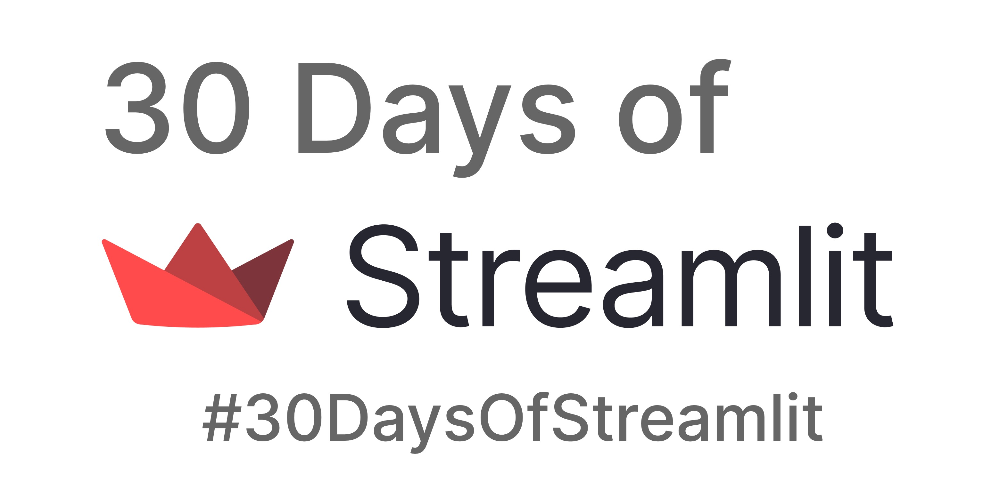

# 30일간의 Streamlit 🎈

`#30DaysOfStreamlit`은 30일 동안 [Streamlit](https://streamlit.io) 앱을 배우고, 만들고, 배포하는 소셜 챌린지입니다. 이 문서는 공식 저장소의 안내를 한국어로 번역한 것이며, 공식 원본 저장소는 [streamlit/30days](https://github.com/streamlit/30days)입니다.

## 참여 방법

참여에 필요한 것은 컴퓨터, Python에 대한 기초 지식, 그리고 호기심뿐입니다. 🧠

매일 새로운 챌린지가 Streamlit의 [Twitter](https://twitter.com/streamlit)와 [LinkedIn](https://www.linkedin.com/company/streamlit/posts/?feedView=all) 계정, 그리고 [`#30DaysOfStreamlit` 앱](https://share.streamlit.io/streamlit/30days/)에 공개됩니다.

매일 챌린지를 완료하고 Twitter나 LinkedIn에서 여러분의 결과물을 공유해 주세요. 멋진 Streamlit 기념품도 받을 수 있습니다! 😎

## 매일 어떤 챌린지를 하나요?

직접 참여해서 각 챌린지의 내용을 확인해 보세요! 다양한 실력의 참가자가 함께할 수 있도록 30일간의 챌린지는 세 가지 난이도로 나뉩니다.

| 초급 (1~7일차) | 중급 (8~23일차) | 고급 (24~30일차) |
| :---        |    :----   |          :--- |
| 로컬과 클라우드의 코딩 환경을 설정하고, Streamlit을 설치한 뒤 첫 Streamlit 앱을 만듭니다. | 매일 새로운 [Streamlit 명령](https://docs.streamlit.io/library/api-reference)을 배우고, 이를 사용해 간단한 Streamlit 앱을 만들고 배포합니다. | 세션 상태, 캐싱을 통한 효율적인 데이터 및 메모리 관리, 복잡한 레이아웃 등 중요한 주제를 배웁니다. |

## 상품

데이터 앱을 가장 빠르고 쉽게 만드는 방법을 익히는 것만으로도 멋진 여름 선물이 되겠지만, Streamlit 기념품까지 받을 수 있습니다!

매일 챌린지를 완료하고 [Twitter](https://twitter.com/streamlit)나 [LinkedIn](https://www.linkedin.com/company/streamlit/posts/?feedView=all)에서 여러분의 결과물을 공유해 주세요. 멋진 Streamlit 기념품을 받을 수 있습니다! 🎁

## 참고 자료

- 매일 챌린지가 게시되는 공식 [`#30DaysOfStreamlit` 앱](https://share.streamlit.io/streamlit/30days/)
- 매일 소식을 전하는 [Twitter](https://twitter.com/streamlit)와 [LinkedIn](https://www.linkedin.com/company/streamlit/posts/?feedView=all) 피드
- Streamlit 명령을 자세히 찾아볼 수 있는 Streamlit [문서](https://docs.streamlit.io/)와 [치트 시트](https://docs.streamlit.io/library/cheatsheet)
- 아이디어와 템플릿, 커뮤니티 앱을 찾아볼 수 있는 멋진 [갤러리](https://streamlit.io/gallery)
- 팁과 최신 Streamlit 정보를 제공하는 [블로그](https://blog.streamlit.io/how-to-master-streamlit-for-data-science/)

## 번역

영어 외에 더 익숙한 언어가 있고, `#30DaysOfStreamlit`을 더 많은 사람에게 알리고 싶으신가요? 챌린지를 원하는 언어로 번역하고 아래에 링크를 추가해 주세요!

- [영어](https://github.com/streamlit/30days) (공식): 
- [벵골어](https://github.com/jojo96/30days-Bengali) ([Ujjayanta Bhaumik](https://github.com/jojo96) 번역): 
- [중국어](https://github.com/TeddyHuang-00/30days-Chinese) ([Nan Huang](https://github.com/TeddyHuang-00) 번역): 
- [스페인어](https://github.com/streamlit/30days-spanish/) ([Emiliano Rosso](https://github.com/arraydude) 번역): 
- [프랑스어](https://github.com/streamlit/30days-French) ([Charly Wargnier](https://github.com/charlyWargnier/) 번역): 
- [힌디어](https://github.com/streamlit/30days-Hindi): 
- [폴란드어](https://github.com/streamlit/30days-polish) ([Michał Nowotka](https://github.com/sfc-gh-mnowotka) 번역): 
- [포르투갈어](https://github.com/franciscoed/30days) ([Francisco Edilton](https://github.com/franciscoed) 번역): 
- [러시아어](https://github.com/kseniaanske/30days) ([Ksenia Anske](https://github.com/kseniaanske) 번역): 
